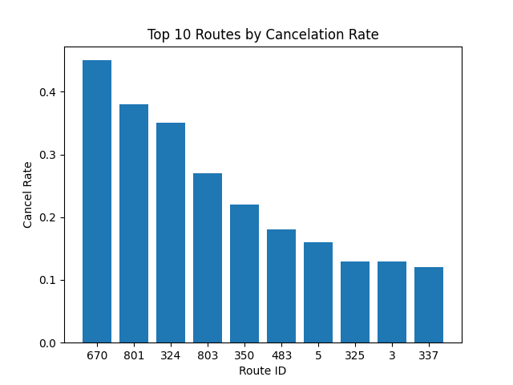
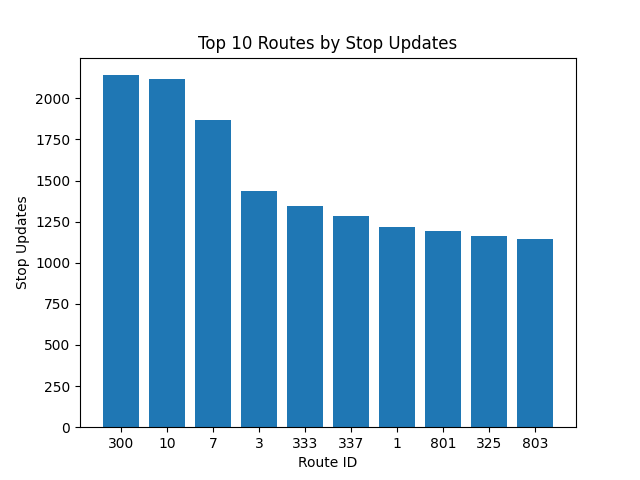
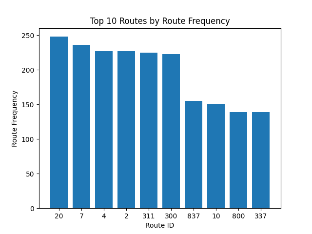
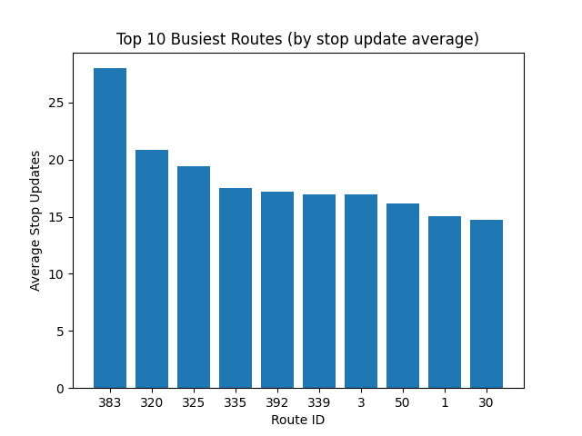
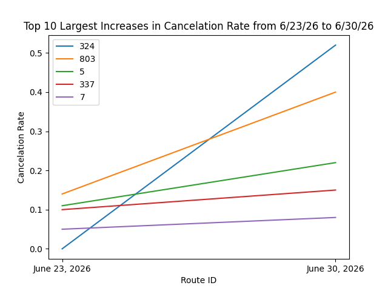
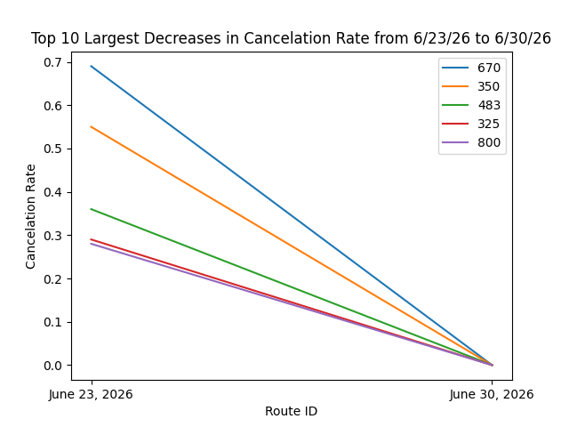
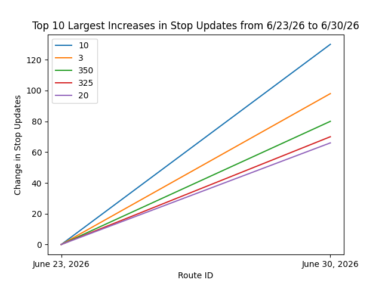
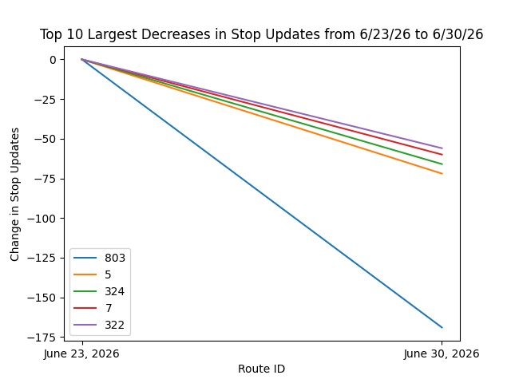

# Overview
This project analyzes interesting statistics and trends from Chicago buses with data taken from their Bus Tracker API on two dates: 6/23/26 and 6/30/26. The analysis consists of two sections, Figures 1-4 are about overall statistics from both dates and Figures 5-8 cover changes from 6/23 to 6/30. This project utilized SQL statements through the SQLite library and matplotlib to generate the figures.

## Overall Statistics

## Changes from 6/23/26 to 6/30/26

